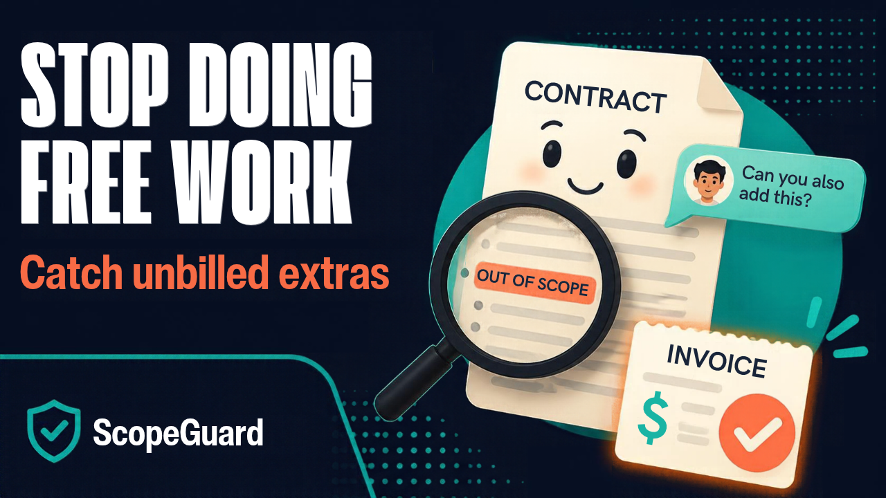

# ScopeGuard - I Built a Local AI That Stops Freelancers Doing Free Work!

**A scope-creep guard for freelancers. It reads your signed agreement and your client's message with an open model on your own laptop, shows what you are about to do for free, and drafts the change order.**

[](https://youtu.be/MQqcnGHszRc)

**Watch the demo: https://youtu.be/MQqcnGHszRc**

A client writes *"great! Could you also make it work on mobile, and one more round on the colours?"* and you say yes,
because checking the contract is tedious and the ask feels small. Over a project that is hours of unbilled work.
ScopeGuard checks every message in seconds.

1. Add a client: paste the agreement, set your rate and a goodwill threshold.
2. Paste the client's message.
3. Get, per request: **covered**, **excluded** (with the clause quoted and highlighted in your contract), or **not covered**, with an hours range, a price, and a draft reply.
4. **Quote it** or **Waive it as goodwill**. The ledger shows what you quoted and what you gave away, and exports to CSV for your invoice.

## The rule it is built on: the model proposes, plain Python decides

| Failure of a plain chatbot | What ScopeGuard does |
|---|---|
| It cites a clause that is not in the contract | Every "covered"/"excluded" verdict must quote the contract. Code finds the quote in your text (ignoring case, punctuation, line breaks). Not found: the verdict is downgraded to **needs you** and the quote discarded. |
| It says the contract "forbids" something it never mentions | **Silence is not exclusion.** No clause means "not covered", worded differently to the client. |
| It does the maths, badly, or promises a price | The model never writes a number. Hours are its estimate, shown as a range; price is hours × **your** rate, computed in code. An opening line containing a digit is replaced. |
| It makes you bill for everything | Requests under your goodwill threshold are flagged as small. Waiving is recorded, so generosity is deliberate and visible. |

The reply to your client is assembled from verified parts only. `src/scopeguard/core.py` is the whole rulebook, about 200 lines.

## Run it

```bash
ollama pull gemma4:e4b                      # ~4 GB; any Ollama model that supports JSON schema works
git clone https://github.com/JayanaGunaweera01/scope-guard.git && cd scope-guard
python -m venv .venv && source .venv/bin/activate     # Windows: .venv\Scripts\activate
python -m pip install -e .
scopeguard                                  # http://localhost:8765 (this computer only)
scopeguard --demo                           # sample client and canned answers, no model needed
```

`SCOPEGUARD_MODEL` changes the model, `OLLAMA_HOST` points at another machine, `SCOPEGUARD_HOME` moves the records
(`~/.scopeguard/scopeguard.json`, readable JSON). Tests: `python -m pytest`.

## Why open models matter for this

- **Privacy is the product.** Agreements are often under NDA and client emails contain their plans and money. A freelancer
  cannot paste those into a hosted API and stay within their own contracts. Here, nothing leaves the laptop: the server binds
  to 127.0.0.1, and the only network call is to local Ollama.
- **The economics only work at zero marginal cost.** The point is to check *every* message, including the small ones where
  creep hides. At a per-token price, a freelancer rations it and misses the ten-minute asks that add up. Locally it is free
  after the download, so it can run on every message.
- **Small, constrained models are enough.** Ollama's JSON-schema decoding makes the output always parse, and the code verifies
  the rest, so a 4B model is trustworthy where a bigger unverified one would not be.
- **No lock-in.** The model is one environment variable. A pricing change, a deprecation or a policy change at a hosted vendor cannot
  break a tool people use to get paid.
- **Room to grow into a niche.** Per-trade clause vocabulary (photography licences, retainers, SaaS SLAs) is what open weights can be tuned
  on; a general API treats every contract alike.

## Who pays, and for what

Solo designers, developers, writers and photographers who bill hourly or per project. The value is concrete: if it catches one
un-billed afternoon per project it pays for itself many times over. A one-time licence or a small monthly fee fits a tool that
costs the maker nothing to run.

## Limits

Not legal advice, and it does not replace reading your contract. It handles the agreement text as pasted (the first ~24,000
characters), one message at a time. PDF import and a browser extension for email are the obvious next steps.

License: Apache-2.0.
